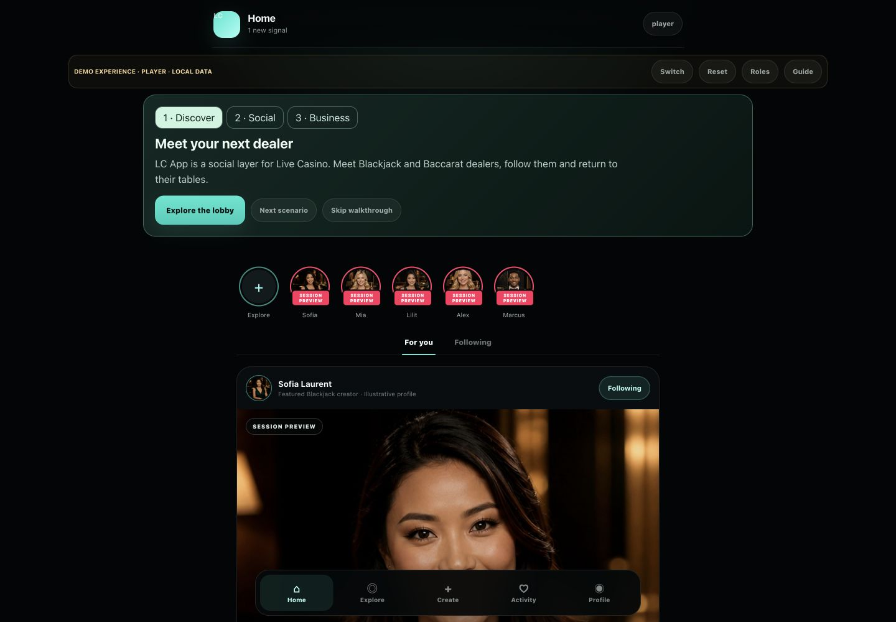
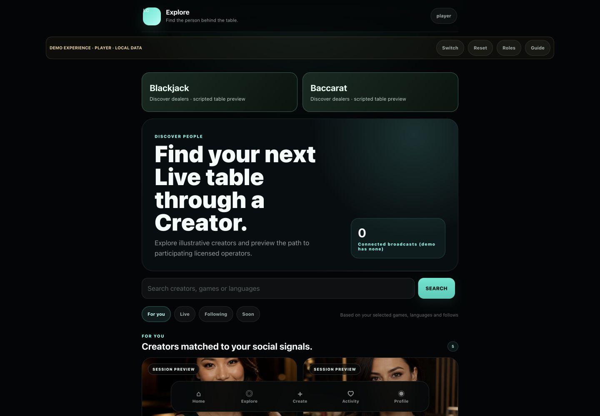
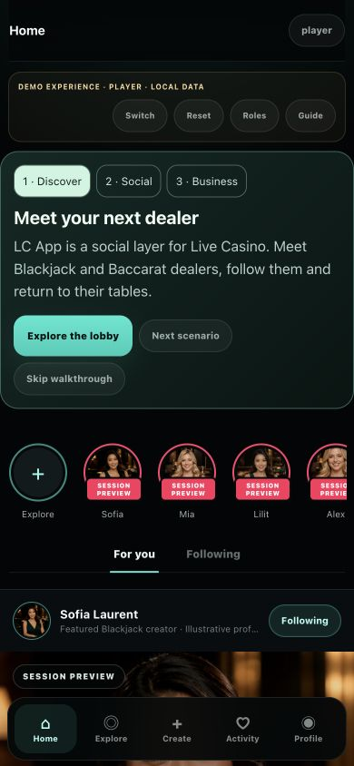
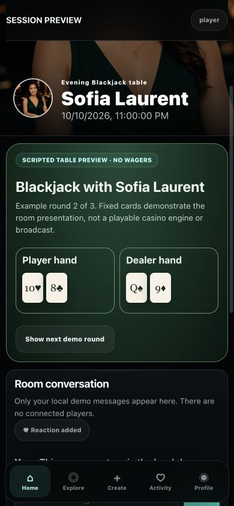

# LC App investor demo readiness

Project: LC App | Version: v0.13 | Status: Local investor demo ready; hosted release NOT ready
Updated: 2026-10-10 | Owner: Narek / product engineering | Audience: investor-demo reviewer and release engineer
Sources: `LC_App_GitHub_Pages_Upload/index.html`, mirrored `app-product.js` / `auth.js` / `sw.js`, actual Codex in-app browser screenshots and QA JSON in `evidence/investor-demo-2026-10-10/`, fresh Node tests, `STAGING_READINESS_REPORT.md`.
Assumptions: All people, content, session schedules and business records are illustrative. Operator/provider value is a hypothesis requiring pilot validation. No real broadcast, customer or partner is represented.
Open questions: Exact Safari error/request attribution, physical iPhone, full VoiceOver and accessibility QA, approved isolated hosting target and sanitised build; separate hosted release blockers remain unchanged.

## Clean-profile Safari follow-up — 2026-10-10

Current application checkpoint remains **146b166**; no application code change. Native Safari control was available in this session. Requested separate profile **LC QA isolated** created; ScreenRecorder and DeepL both unchecked in its Extensions panel (`clean-profile-extensions.txt/.png`). Safari automatically established a Personal profile from the previous settings; existing-profile extension settings were not changed. QA profile is retained for subsequent testing.

**Permission-error environmental gate: PASS in the tested clean profile.** Both errors disappeared on Inspector opening at 17:14:44, application reload and Inspector reopening after keyboard checks. Clean console evidence: `evidence/safari-accessibility-closure-2026-10-10/clean-profile-console.txt/.png` and `clean-profile-console-final.txt/.png`. Application code/server remained the same. Combined with prior errors on static CSS without LC JavaScript, this identifies the pair as browser/extension-environment dependent, not a confirmed LC application defect. DeepL/source-map loading remains the likely mechanism; Safari did not expose exact per-error URL or initiator, so one-to-one mapping is still NOT VERIFIED. No error suppression or application workaround was added. Safe demo workaround: use this extension-free QA profile.

Remaining primary investor keyboard reachability checked: lobby, dealer profile, scripted room, handoff, Activity, Player Profile, walkthrough and operator workspace. `keyboard-remaining.txt` adds 216 actual focus records, including reverse navigation and Return activation. Scenario activation retains its focused scenario button; handoff return focuses the room heading. Cycles reach primary controls and navigation without an observed trap. Earlier Home/interactions/reduced-motion evidence stays valid. This completes the listed primary reachability checks, **not** every optional safety/Creator/business form, overlay or WCAG conformance test.

VoiceOver process access again timed out (-10005); no additional speech/rotor evidence. Stopped retrying. **VoiceOver walkthrough BLOCKED**, physical iPhone **BLOCKED** (no newly available device established). **INVESTOR DEVICE READY: NO.** No code changed; regression was not rerun. 127/127 is the prior verified 146b166 result. Full contrast/text-scaling and optional overlay coverage retain prior partial status.

## Safari error investigation and accessibility closure — 2026-10-10

**Investor device readiness: NO.** Native macOS Safari 26.6.2 was used; this section supersedes the earlier device checkpoint below. Evidence directory: `evidence/safari-accessibility-closure-2026-10-10/`. Final runtime verified in Safari: app v124, shell v20, cache v134. No hosted changes, environment changes, deployment or push.

### Resource-permission errors

Both exact messages: **Failed to load resource: You do not have permission to access the requested resource.** Initial private-window reproduction: error 1 and error 2 at **16:40:44.394**; final reload: error 1 **17:02:49.744**, error 2 **17:02:49.745** (2026-10-10, Asia/Yerevan UTC+4). See `private-console.png` and `final-runtime.txt`. Each message lacks an exposed resource URL/stack; a one-to-one assignment remains unresolved.

The same pair appears on `http://localhost:4187/product-shell-v2.css`, which runs no LC application JavaScript, at **16:44:47.527** (`static-control-console.png`, `static-control-console.txt`). Reopening Web Inspector without an application reload adds another pair (16:44:04.540, 16:51:03.630, 16:56:52.400). An about:blank control showed zero errors (`blank-console.png`). Private Browsing supplies fresh storage but DeepL remains active: this was **not an extension-free Safari profile**.

Native Sources inspection exposed extension scripts `content_ui.js` and `content.js`, each declaring a matching source map. Candidate resources are `safari-web-extension://F8B6E1FB-3F8B-439C-A901-A50A4DC7A902/content_ui.js.map` and `safari-web-extension://F8B6E1FB-3F8B-439C-A901-A50A4DC7A902/content.js.map`; candidate initiator is Safari Web Inspector's source-map loader. This is an **evidence-based hypothesis, not confirmed per-error URL attribution**. `extension-source-map.png` captures a source-map directive. The injected `assets/nord.min.css` was loaded from cache, initiated by `content.js:1:15644`; it is not a confirmed failed resource (`private-network.txt`).

The static control rules out LC JavaScript as a necessary cause. No broken loaded application images or blocked investor scenario was observed; final DOM audit lists no broken images. No application correction or error suppression was applied for these messages. Safe next diagnostic/workaround: repeat in a genuinely extension-free Safari profile; if the pair disappears, isolate the extension/source-map permission failure. No extension or browser security protection was disabled in this session. Console gate remains BLOCKED until exact request/initiator attribution or a clean-profile result is captured.

### Accessibility and functional checks

| Area | Result and precise scope |
|---|---|
| Keyboard/focus | PARTIAL overall. Complete Home traversal recorded 63 app controls in reading order; selected lobby, dealer, comment and room keyboard interactions passed. Fixed lost focus after Like/follow/chat/round re-render, guide heading stealing route focus, and same-title dealer-to-room hash navigation. Full page-by-page traversal/escape behavior still requires acceptance. |
| Names/state | Native AX verified follow, profile Like, room reaction and For you/Following toggle states; existing labelled comment/chat inputs. No claim that every app surface was audited. |
| Comment errors | Whitespace-only comment now opens native validation with “Enter a message within the displayed length limit.”; editing clears validity and a valid local comment succeeds. Focus remains on Post comment after submission. Evidence: `comment-error.png`, journey and focus records. |
| Reduced motion | PASS for sampled runtime controls. macOS Reduce motion was enabled temporarily; native Safari reported matchMedia=true and computed animation/transition durations 0.00001s. `reduced-motion-runtime.txt` contains actual result. Original preference restored off. Not an exhaustive animation inventory. |
| Contrast | Confirmed 12px inactive Following text was about 4.1:1 on the app background; changed to #b6cfc7 and verified computed rgb(182,207,199). Full contrast audit, particularly image overlays, remains PARTIAL. |
| Text scaling | Native Make Text Bigger used five increments and then restored with five decrements. Desktop sample inspected (`text-scaling-five-steps.png`); exact scale percentage and all-page/mobile reflow not measured. |
| Walkthrough/modal | Three scenarios, skip, Guide restart, operator workspace and reset exercised in native Safari. Guide is an inline section, not a modal. Native validation popover tested; other modal/sheet focus traps not comprehensively verified. |
| VoiceOver | BLOCKED for completed walkthrough. Available and temporarily enabled; VoiceOver process access timed out and speech/cursor output could not be verified through automation. AX inspection is not a VoiceOver substitute. Original VoiceOver off state restored. Manual speech/rotor walkthrough required. |
| Physical iPhone | BLOCKED. Safari Inspect Apps and Devices showed only This Computer; no connected inspectable iPhone. `native-devices.png`. No physical or native iOS acceptance claimed. |

Native Safari journey exercised entry, lobby, Blackjack and Baccarat dealer/room previews, follow/unfollow, likes/comments/chat, next scripted rounds, all guided scenarios, operator value, Home, skip/restart and reset (`journey.txt`). Final v124/v20 recheck confirms feed filter states, corrected colour, lobby/dealer/room heading focus and zero broken images. Previous nominal 320/390/768/1440 Safari RDM screenshots remain historical c406601 evidence; no new physical-device coverage claimed. No observed JavaScript exception; exhaustive unhandled-exception instrumentation was not available.

Regression: **127/127 existing Node tests PASS**, including three behavioral VM regressions for page-heading focus, interaction focus/scroll restoration, and same-title detail navigation. Syntax, mirrored runtime parity and diff checks are recorded at handoff. Full accessibility and device gate remain open. Hosted baseline PASS and unresolved 052–054 provenance, hosted Auth/RLS/Storage E2E, integrations, backup/recovery and hosted browser testing remain unchanged.

## Native Safari and device acceptance — 2026-10-10

**Native Safari functional smoke PASS; final investor device gate NOT COMPLETE.** Actual macOS Safari 26.6.2 was operated through native UI automation. No Chromium results substitute for Safari. Canonical evidence: `evidence/investor-device-acceptance-2026-10-10/acceptance-results.json`, native PNG screenshots, `safari-runtime-all-widths.txt`, `safari-accessibility-final.txt` and fresh `unit-tests.log`.

Verified in native Safari: guest entry, three guided scenarios, skip/Guide restart, lobby (including keyboard activation), Sofia profile, follow/unfollow/refollow, feed Like off/on, profile/feed comments, Blackjack/Baccarat scripted rounds and local chat, primary Home navigation, and seed reset. Operator walkthrough action opens the local back office with explicit unverified integration/value claims. Reset removes local comments and returns the base player route. No wagering, broadcast or production integration claim was added.

Confirmed local defects fixed: hidden prototype Quick actions received the first keyboard focus; demo Like state was absent from AX; feed avatar buttons had generic names and decorative images received redundant alt text; focus outlines were inconsistent; timestamp/comment counts had low contrast; a comment count squeezed the input at 320px; Home left a stale dealer/room hash. Investor-scoped styling and a VM navigation regression preserve local demo isolation. Final runtime: app v122, shell v18, cache v132; mirrored sources remain identical.

Layout coverage: real Safari Responsive Design Mode at nominal **320, 390, 768 and 1440 × 844**, 2x. Screenshots include the size controls. Selected feed, lobby, profile, room and entry screens were inspected; not every screen at every width. Zero observed horizontal page overflow and broken loaded images. Inspector docking at 13% scale rounded measured widths to 321/392/765 for the three smaller nominal widths; 1440 measured exactly, and an earlier 320 inspection measured exactly 320. This is macOS Safari responsive evidence, not iOS or physical iPhone validation.

Accessibility is **PARTIAL**: sampled Option-Tab traversal, visible focus and Return activation passed; native AX exposes labelled inputs/buttons/main region and the Like pressed state. Decorative empty alt remains decorative. Feed metadata now computes to `rgb(182,207,199)` and 12px. Reduced-motion CSS is present and reviewed, but the runtime preference was false; reduce-mode behavior and a complete VoiceOver audio/rotor journey are **NOT VERIFIED**. No WCAG conformance claim.

Safari console gate remains **BLOCKED**: two “Failed to load resource: You do not have permission to access the requested resource” errors appeared before and after fixes. Network includes a Web Translator for DeepL injected stylesheet, but both errors could not be attributed reliably. No JavaScript exception was observed; this is not exhaustive unhandled-rejection instrumentation. Physical iPhone testing is **BLOCKED** because no connected device surface is available.

Regression: **124/124 Node tests PASS**, JavaScript syntax, root/nested runtime parity and `git diff --check` PASS. The new VM test verifies detail-hash clearing without remounting demo data. Earlier browser evidence below remains historical. Hosted baseline PASS and all hosted release blockers remain unchanged. **INVESTOR DEVICE READY: NO.** Next: isolate/resolve Safari resource errors, then complete physical iPhone and VoiceOver/reduced-motion checks.

## Visual acceptance — 2026-10-10

**PASS for the local investor demo in the tested Codex in-app browser.** This does not approve native Safari/iPhone, hosted release or production. Canonical evidence: `evidence/investor-visual-acceptance-2026-10-10/` (`before/`, `after/`, `browser-results.json`, `unit-tests.log`). Screenshots are real browser captures, not generated mockups.

| Verified defect | Local correction | Evidence |
|---|---|---|
| Demo banner and guide widths diverged from the player content | Align both to the 760px player column; inset mobile guide | Desktop/mobile entry BEFORE/AFTER |
| Lobby headline occupied four desktop lines and displaced discovery | Smaller headline, compact broadcast-state block | `before/desktop-lobby.jpg`, `after/1440-lobby.jpg` |
| Mobile guide copy/actions consumed excessive vertical space | Compact readable copy and controls; skip remains available | `before/390-entry.jpg`, `after/390-entry.jpg` |
| Preview rail used a 7px pink badge resembling live status | Readable mint PREVIEW badge with full accessible status | Entry BEFORE/AFTER |
| Tall profile/feed imagery concealed identity and interactions | Shorter profile hero and responsive feed crops | Dealer and feed captures |
| Profile comments/forms overlaid photography and could exceed a fixed card | Separate image/content blocks; cards grow with comments; wrap long text | Dealer-comments BEFORE/AFTER; long-comment browser check |
| Feed comments were too small and comment submission jumped to the top | Readable comment styling; preserve scroll after local submission | Feed-comments AFTER; measured identical pre/post scroll at both widths |
| Business sidebar said Online despite no integration | Label Local demo | Desktop operator/provider AFTER |
| Reset retained search and stale detail context | Clear query/selected dealer/room during seed reset | Browser reset checks and new VM regression test |

Coverage: 1440×1000 desktop and 390×844 responsive mobile. Inspected initial in-app entry, lobby, dealer profile and updates, feed/comments, Blackjack/Baccarat portraits/table/chat, operator/provider overviews, guided scenarios, skip/restart and primary navigation. The 14 recorded layout checks have zero page/app horizontal overflow and zero observed broken loaded images. The preview rail and mobile business navigation intentionally scroll horizontally. Long comments remain in normal document flow and can be scrolled below the fixed navigation.

Functional browser regression: **49 checks PASS**, zero captured console errors. Checks cover likes, comments, follow/unfollow, both fixed table rounds, local chat/reaction, operator/provider navigation, game discovery, empty search recovery, guest profile, notifications, seed reset, walkthrough and local handoff/return. Evidence was captured incrementally during fixes (app assets v117–v121); final runtime is app-product v121, shell v17, cache v131. Final comment/reset fixes were exercised after loading the updated runtime. Node regression: **123/123 PASS**; syntax, mirrored runtime parity and diff whitespace checks PASS.

Remaining limitations: native Safari/physical iPhone and full accessibility audit NOT VERIFIED; static imagery and scripted cards are intentional; real streams, wagering and integrations are unavailable. Business access status still uses an internal `not_requested` label (minor copy refinement). Hosted 052–054 provenance, Auth/RLS/Storage E2E, integrations, backup/recovery and hosted browser tests remain blocked. No Supabase, production, DNS, environment, push or deployment action occurred.

Next acceptance gate: run the same journey in native Safari and on a physical iPhone before presenting that compatibility as verified. Earlier sprint evidence below is historical and retained for traceability.

## Product entry and execution

- Open **http://localhost:4187/investor.html**. It immediately opens the actual social product at **http://localhost:4187/?app=1&demo=investor#/product/demo/player**.
- Server document root: `LC_App_GitHub_Pages_Upload/`; root `index.html` is a different presentation/marketing surface and is not the product entry.
- Server is a loopback-only Python static development server on port 4187. No build dependencies were added. If stopped: `python3 -m http.server 4187 --bind 127.0.0.1 --directory LC_App_GitHub_Pages_Upload`.
- Dealer route: `#/product/demo/player/creator/demo-sofia`; Blackjack room: `#/product/demo/player/live/demo-session-sofia`; Baccarat room: `#/product/demo/player/live/demo-session-alex`. Keep `?app=1&demo=investor` on every URL.
- Home, Explore, Create, Activity and Profile navigation operate inside the product. Role routes include `#/product/demo/creator`, `#/product/demo/operator`, `#/product/demo/provider`, `#/product/demo/admin`.
- Investor entry bypasses Auth initialisation before config/session access and skips the Supabase SDK download. Four observed scripts are local: social.js, app-product.js, auth.js and product-shell-v2.js. Demo client is null; interactions remain in memory. Existing authenticated paths stay separate.
- Do not remove the investor query flag and call the default app shell an isolated demo: the canonical shell still contains its pre-existing production configuration. This matters for the proposed separate deployment below.

## Feature inventory — actual UI and evidence scope

VERIFIED means exercised or observed in the local browser in the stated demo scope. PARTIAL means present but incompletely verified or backend-dependent. NOT IMPLEMENTED describes intentionally absent capability. BROKEN identifies the discovery defect; repaired rows show the resulting status. Passing unit tests alone does not promote a row to VERIFIED.

| Feature | Discovery → final | Working scope / dependency | Browser evidence |
|---|---|---|---|
| Immediate guest product entry | PARTIAL → VERIFIED | Dedicated investor.html and early demo Auth bypass; no registration | Direct entry and walkthrough |
| Live Casino lobby | PARTIAL → VERIFIED | Blackjack/Baccarat cards search supported dealer games; cards do not imply available operator tables | Lobby and Blackjack search; Baccarat profile/room |
| Dealer profiles and avatar/details | VERIFIED → VERIFIED | Five fixed illustrative profiles and existing local imagery | Dealer at all tested widths |
| Follow/unfollow | VERIFIED → VERIFIED | Session-memory relationship state | Explicit final dealer toggle checks |
| Feed likes | BROKEN → VERIFIED | Reversible like state with visible update; no real engagement count | Feed and dealer post interactions |
| Feed/dealer comments | PARTIAL → VERIFIED | Escaped visible comments instead of count-only confirmation; max 500 characters | Feed comment and dealer profile comment |
| Notifications and reminders | VERIFIED → VERIFIED | Local in-app example signals, mark-read and virtual-clock reminders; no email/SMS/push delivery | Activity/read state, reminder and reset |
| Guest user profile | VERIFIED → VERIFIED | Demo Reviewer identity/preferences/follows/saved cues | Profile navigation and layouts |
| Blackjack/Baccarat game room | PARTIAL → VERIFIED | Static dealer stage, three scripted card rounds, local chat/reaction and handoff preview | Both room round flows; mobile interaction capture |
| Genuine wagering/game engine | NOT IMPLEMENTED → NOT IMPLEMENTED | Intentionally external to LC; no deposits, wagering controls, RNG/certification or financial outcomes | Scripted table disclosure and unit boundary checks |
| Video/streaming | NOT IMPLEMENTED → NOT IMPLEMENTED | Static local dealer images; no connected broadcast | Preview labels; no live activity claimed |
| Three investor scenarios | NOT IMPLEMENTED → VERIFIED | Non-blocking guide, direct scenario choice, skip, finish and restart | Three scenarios; deep-link skip; final restart |
| Social/business role switching | BROKEN (revealed by scenario QA) → VERIFIED | Root business-view metadata no longer intercepts social actions | Browser regression and executable regression test |
| Operator/provider workspaces | PARTIAL → PARTIAL | Presentation/configuration surfaces observed; no real tenants, integration, campaign execution or performance data | Operator/provider layouts; operator scenario |
| Creator publishing/scheduling workflow | PARTIAL → PARTIAL | Existing demo/backend implementation; not fully exercised in this sprint | Existing contract tests only; no browser completeness claim |
| Account signup/reset/verification | PARTIAL → PARTIAL | Existing Supabase-dependent code; guest demo does not use it | Not verified hosted |
| RLS/Storage/tenant permissions | PARTIAL → PARTIAL | Prior local SQL simulation and contracts; hosted staging remains empty | Unit/local evidence only, not hosted E2E |
| Mobile/desktop layout | PARTIAL → VERIFIED | 320/390/430/768/1440 px app layout smoke, not physical-device certification | 40 checks, zero overflow or broken loaded images |
| Error and empty-result recovery | PARTIAL → VERIFIED | Unknown session, malformed route and empty search recover to lobby/results | Recovery checks |
| Full accessibility/Safari certification | PARTIAL → PARTIAL | Named controls and readable layout; broader accessibility and native Safari remain unverified | Not verified comprehensively |

## Three self-guided scenarios

1. **Discover:** read what LC App is in the app, open the lobby, choose Blackjack or Baccarat and open a dealer profile. Supporting dealer games and available example sessions are distinct; select Alex for the Baccarat room.
2. **Social:** follow/unfollow, like and comment on an update, save a reminder, open the room, advance a scripted round, add a local message/reaction, preview the licensed-operator boundary and simulate return. No outbound operator destination exists.
3. **Business:** inspect the operator workspace. LC owns discovery/identity/social/return context; licensed infrastructure owns gameplay, wallet, KYC/AML, wagering, settlement and responsible gaming. Provider workspace illustrates a distribution use case. No uplift, GGR, integration or pilot success is claimed.

Skip keeps the current linked screen. Guide restarts the walkthrough in Player mode with a clean seed; Reset resets the current demo persona's state. Page reload starts a clean demo. No visitor login is required.

## Reliability and defects fixed

- Deterministic five-profile/five-session seed with virtual epoch `2026-10-10T18:00:00Z`. Seed schedules are examples, not current availability. Interaction timestamps may use actual local time; seeded scheduling eligibility uses virtual time.
- Fixed Like's missing visible state update and provided unlike. Comments now render escaped text on feed and dealer profile.
- Added explicitly scripted tables, max 20 room messages of 240 characters each, reversible room reaction and safe reset. Nothing represents connected players or a real casino engine.
- Restricted business-view event handling to actual buttons; deleted stale business metadata in social mode. This prevents operator-to-player clicks returning to a business screen.
- Preserved linked room when skipping the guide; room updates change only table/chat content rather than rebuilding the whole application screen.
- Shortened mobile guide, replaced empty dealer rail with labelled session previews, reduced static demo stage height and removed sticky handoff CTA from demo-room content flow to avoid chat-input obstruction.
- Updated scoped service-worker cache to v126 and product asset to v116. Root/nested runtime files match; no marketing source was edited.

## QA evidence

| Category | Result | Limits |
|---|---|---|
| Browser responsive layouts | **40/40 PASS**, 8 screens × 5 widths | Document/product horizontal overflow and broken completed images; inner rails intentionally scroll |
| Browser interactions | **24 PASS**, **0 console errors** | Codex in-app browser, no real backend or physical-device coverage |
| Fresh Node suite | **122/122 PASS** | Includes demo Auth bypass, fixed seed, escaped table text, role-switch interception and virtual reminder tests |
| Syntax / runtime mirror parity / diff hygiene | PASS | Static/local checks |
| Hosted Auth/RLS/Storage/integrations | NOT RUN | No hosted writes or migrations authorised |
| Native Safari/WebKit / actual iPhone / full a11y | NOT VERIFIED | Prior browser evidence is historical, not this sprint's signoff |

Raw local results: `evidence/investor-demo-2026-10-10/browser-layout-results.json`, `browser-interaction-results.json`, `unit-tests.log`. Layout capture used v115; final v116 changes only reminder-clock eligibility and is covered by the added unit test and final browser reminder check. No layout change followed the 40-screen capture.

Accepted actual-app screenshots (captured and visually inspected):

## Local investor-demo release checklist

- [x] Actual app opens directly, guest mode works without registration.
- [x] What LC is, social loop, operator/provider rationale and working demo scope are visible in-app.
- [x] Lobby, profiles, follows, feed interactions, notifications and both table previews exercised.
- [x] Guide choice/skip/restart, state reset and invalid/empty recovery checked.
- [x] Deterministic seed, null demo client, skipped Supabase SDK, no privileged secret added.
- [x] Responsive browser evidence, screenshots, fresh tests and mirrored runtime parity recorded.
- [ ] Native Safari/physical iPhone investor acceptance.
- [ ] Review and produce an isolated, sanitised static deployment artifact; this source tree is not that artifact.
- [ ] Separate approval for any external hosting publication.

**INVESTOR DEMO READY: YES for local, illustrative product presentation in the tested browser. STAGING MIGRATION READY: NO. PRODUCTION READY: NO.** No hosted migration, Supabase production change, push, deployment, DNS or environment modification occurred.

## Isolated deployment proposal — prepared, not executed

Use a dedicated static demo project/origin with no Supabase, API secrets, database, SMTP, webhooks, production sessions or automatic production deployment linkage. Keep it separate from the current public app and OpenGamer marketing site.

Before publication, build a curated artifact from reviewed local assets/app styles and demo renderer. Replace the canonical Auth driver with a minimal demo-only driver, omit production config/SDK/auth/admin backend client code and enforce demo-only routes so deleting a query flag cannot activate production Auth. Retain labelled demo controls, disclosures and static images. Pin the exact reviewed commit, hash the artifact and inspect all generated files.

Apply a reviewed CSP limited to self-hosted scripts/styles/images and no external API connections; verify the allowlist and inline-code handling against the built artifact. Use a unique service-worker/cache scope and explicit noindex. Test the full guest journey, network requests, reset, deep links, mobile/Safari, unavailable-asset fallback and rollback to the prior immutable static artifact on the separate preview origin. Record what was tested before requesting publication approval.

Not performed: artifact sanitation, target creation, preview deployment, DNS linkage or hosted verification. Do not deploy the repository wholesale or use the historical STAGING_HANDOFF.zip as this artifact. Founder approval is required for the final reviewed publication target/artifact.

## Separate hosted release blockers

052–054 source provenance, hosted Auth/RLS/Storage E2E, integration isolation, backup/recovery and authenticated browser tests remain open. The accepted empty hosted baseline PASS is sourced to ChatGPT connected Supabase on 2026-10-10; local demo readiness does not alter those gates. See `STAGING_READINESS_REPORT.md` and `DISPOSABLE_SUPABASE_RECOVERY_RUNBOOK.md`.

Next best action: run the local investor journey in native Safari on the intended investor device and record acceptance before preparing the isolated publication artifact.
